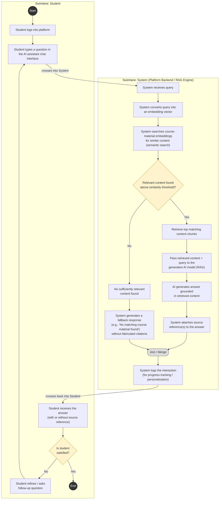

# IT314 – Lab Assignment 6: Requirement Formalization & Process Modeling
## Project: AI-Powered Online Learning Platform

---

## 1. Stakeholders & Elicitation

| # | Stakeholder / End User | Elicitation Technique(s) | Status | Gathered So Far / Plan |
|---|---|---|---|---|
| 1 | **Students / Learners** (primary end users) | Informal peer interviews + a short questionnaire circulated among classmates who represent the target user group | **Ongoing** | So far: confirmed core needs — asking doubts in natural language, getting explanations tied to actual course material (not generic web answers), and tracking their own progress. Remaining: a wider survey (target ~20–25 respondents) to prioritize features and capture pain points with existing platforms (e.g., Moodle, Coursera). To be closed out by circulating the survey this week and consolidating responses before the next milestone. |
| 2 | **Instructors / Content Creators** | Structured interview (one instructor consulted informally as a faculty perspective) | **Ongoing** | So far: instructor input on the need for content upload/management and visibility into which topics students struggle with. Remaining: a follow-up interview to clarify how much control instructors want over the AI's answers (e.g., approving/restricting AI responses to their uploaded material). To be completed via a scheduled short interview. |
| 3 | **Course/Platform Administrator** | Brainstorming within the project team, acting as proxy for this role since a real administrator is not yet available | **Ongoing** | So far: identified basic needs — user/course management, monitoring platform usage. Remaining: no direct elicitation done yet with an actual admin-type user; team will continue to model this role internally and revisit if an appropriate contact becomes available. |
| 4 | **AI/RAG Subsystem Requirements Source** (indirectly elicited via technical constraints, not a human stakeholder) | Document analysis of RAG/embeddings/federated-learning literature and prior lab material | **Ongoing** | So far: general understanding of what RAG-based Q&A and federated learning require functionally. Remaining: refine as the technical design solidifies during implementation. |

**Note:** Since this is a semester-long class project without access to a real institution's staff, elicitation for Instructors and Administrators is being done through limited/proxy interviews and is explicitly marked provisional. Requirements derived from these are marked accordingly below.

---

## 2. Requirements Documentation

### 2.1 Functional Requirements (FRs)

| ID | Requirement | Source Stakeholder | Status |
|---|---|---|---|
| FR-01 | The system shall allow students to register and log in securely to access course content. | Students | Finalized |
| FR-02 | The system shall allow instructors to upload and organize course material (documents, notes, videos). | Instructors | Provisional |
| FR-03 | The system shall convert uploaded course material into embeddings for semantic search and retrieval. | AI/RAG source | Provisional |
| FR-04 | The system shall allow students to ask natural-language questions and receive answers generated via Retrieval-Augmented Generation (RAG) grounded in the relevant course material. | Students | Ongoing |
| FR-05 | The system shall retrieve the most relevant content chunks (via embedding similarity search) before generating an AI response, and shall cite/reference the source material used. | Students, AI/RAG source | Provisional |
| FR-06 | The system shall track each student's learning progress (topics covered, quiz performance, query history) to personalize future content and recommendations. | Students | Ongoing |
| FR-07 | The system shall provide personalized recommendations (topics to revise, next content to study) based on the student's tracked progress. | Students | Provisional |
| FR-08 | The system shall support federated learning, allowing student-interaction data to improve the personalization/recommendation model without raw data leaving the student's device/institution. | AI/RAG source | Provisional |
| FR-09 | The system shall allow instructors to view aggregated (non-identifying) insights into common student doubts or weak topics. | Instructors | Provisional |
| FR-10 | The system shall allow students to take quizzes/assessments related to course content and receive automated feedback. | Students | Ongoing |
| FR-11 | The system shall maintain a record of each student's conversation history with the AI assistant for later review. | Students | Ongoing |

### 2.2 Non-Functional Requirements (NFRs)

| ID | Requirement | Category |
|---|---|---|
| NFR-01 | AI-generated responses to a student query shall be returned within an acceptable response time (target: a few seconds) to maintain a usable learning experience. | Performance |
| NFR-02 | All user data (credentials, learning history) shall be stored and transmitted securely (e.g., encrypted in transit and at rest). | Security |
| NFR-03 | Student interaction data used for federated learning shall remain private — only model updates, not raw personal data, shall be shared/aggregated. | Privacy |
| NFR-04 | The system shall be able to scale to support an increasing number of concurrent students and growing course content without significant degradation. | Scalability |
| NFR-05 | The system shall remain available and functional even if the AI/RAG subsystem experiences partial failure (e.g., degrade gracefully rather than crash). | Reliability |
| NFR-06 | The platform's interface shall be simple and intuitive enough for students with no technical background to use without training. | Usability |
| NFR-07 | The codebase shall be modular (separating frontend, backend, AI/RAG components) to allow maintainability and independent updates. | Maintainability |
| NFR-08 | The platform shall be available for access during expected usage hours with minimal downtime. | Availability |

### 2.3 Domain Requirements

| ID | Requirement | Rationale |
|---|---|---|
| DR-01 | The system must comply with data protection norms applicable to educational/student data (e.g., not exposing personally identifiable learning records). | Educational data privacy is a domain-specific legal/ethical concern, distinct from general security. |
| DR-02 | AI-generated answers must be traceable to the source course material used (via RAG retrieval), rather than presented as unverified generative output, to preserve academic trust. | In an educational domain, unattributed AI answers risk misinformation and reduce credibility. |
| DR-03 | The federated learning mechanism must ensure that no raw student data (queries, answers, personal identifiers) leaves the local context — only model parameter updates are shared. | This is a domain constraint arising from combining AI/ML techniques with sensitive educational data. |
| DR-04 | The platform should follow basic e-learning accessibility considerations (e.g., readable text, reasonable contrast) so it is usable by a broad range of students. | Accessibility is a recognized norm specific to the e-learning domain. |

*(FR/NFR/DR items marked "Provisional" or "Ongoing" above are drawn from elicitation that is still in progress and are subject to revision once elicitation is completed.)*

---

## 3. Activity Diagram (To Be Hand-Drawn)

### Selected Functionality
**"Student Asks a Question and Receives an AI-Generated (RAG-based) Answer"**

This flow is chosen because it involves multiple steps, more than one actor, a clear decision point (whether relevant content is found), and an alternate path (fallback when no good match exists).

### Actors / Swimlanes
Draw **two vertical swimlanes**:
1. **Student**
2. **System (Platform Backend / RAG Engine)**

*(Instructor is not directly involved in this particular flow, so a third swimlane is not needed here.)*

### Step-by-Step Flow to Draw

**Swimlane: Student**
1. **Start (filled circle)** → "Student logs into platform"
2. Box: "Student types a question in the AI assistant chat interface"
3. Arrow crosses into System swimlane

**Swimlane: System**
4. Box: "System receives query"
5. Box: "System converts query into an embedding vector"
6. Box: "System searches course-material embeddings for similar content (semantic search)"
7. **Decision (diamond):** "Relevant content found above similarity threshold?"
   - **Yes branch:**
     8a. Box: "Retrieve top matching content chunks"
     9a. Box: "Pass retrieved content + query to the generative AI model (RAG)"
     10a. Box: "AI generates answer grounded in retrieved content"
     11a. Box: "System attaches source reference(s) to the answer"
   - **No branch (alternate path):**
     8b. Box: "No sufficiently relevant content found"
     9b. Box: "System generates a fallback response (e.g., 'No matching course material found' / general guidance) without fabricated citations"

12. Both branches merge back with a **merge bar (join)** into: Box: "System logs the interaction (for progress tracking / personalization)"
13. Arrow crosses back into Student swimlane

**Swimlane: Student**
14. Box: "Student receives the answer (with or without source reference)"
15. **Decision (diamond):** "Is student satisfied?"
    - **No:** loop arrow back to step 2 ("Student refines/asks follow-up question")
    - **Yes:** proceed to end
16. **End (filled circle with ring)**

### Notes for Drawing
- Use a **rounded rectangle** for each activity/action box.
- Use a **diamond** for each decision point, with labeled arrows for each branch (e.g., "Yes"/"No").
- Use a **merge/join bar** (a thick horizontal or vertical line) where the two branches (relevant content found vs. not found) reconnect before logging.
- Keep the two swimlanes clearly separated by a vertical line, with arrows crossing the line only where control passes from Student to System or back.

# Activity Diagram — "Student Asks a Question and Receives an AI-Generated (RAG-based) Answer"

## Legend
- **Rounded boxes** = activities/actions
- **Diamonds** = decision points (Yes/No branches)
- **Filled circle** = Start; **filled circle with ring look** = End
- **Join node** = merge point where the "Yes" (relevant content found) and "No" (no relevant content) branches reconnect before logging the interaction
- Two subgraphs represent the two swimlanes: **Student** and **System (Platform Backend / RAG Engine)**
- Arrows crossing subgraph boundaries represent control passing between Student and System, matching the hand-drawn diagram spec in Section 3 of the assignment

## Notes
- This Mermaid version is a **digital stand-in** for the hand-drawn diagram — GitHub, GitLab, and most Markdown viewers (and the Mermaid Live Editor: https://mermaid.live) will render it directly.
- If your assignment strictly requires a **hand-drawn** diagram, use this as a reference/checklist while drawing it manually — every box, decision, and branch listed in Section 3 is represented here in the same order.