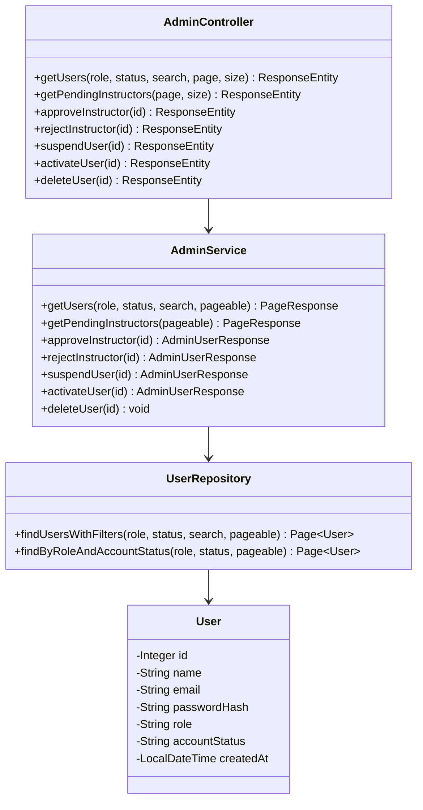

# Phase 1 Implementation Plan — User Management & Instructor Approvals

**Target Module:** Admin Backend (Spring Boot)  
**Features Covered:**
- Feature 12: Admin Login & Security (`FR-A01`)
- Feature 13: User Management Dashboard (`FR-A02`)
- Feature 14: Instructor Approval Workflow (`FR-A03`, `FR-I01`)
**Dependencies on other teammates:** **None** (zero dependencies). Builds directly on top of existing `User.java`, `UserRepository.java`, and Spring Security JWT filter.

---

## 1. Goal Description

Establish the core administrative and governance capabilities for the platform:
1. Allow platform administrators to authenticate and access elevated endpoints under `/api/admin/**`.
2. Provide a master user directory allowing admins to list, filter, suspend, activate, and delete user accounts.
3. Enforce the instructor verification gate: newly registered instructors cannot access course-creation capabilities until an admin reviews and approves them from a dedicated approval queue.

---

## 2. Database Adjustments Required (Prerequisites)

Because `spring.jpa.hibernate.ddl-auto=validate` is active in `application.properties`, the database schema must match the updated entity mappings.

```sql
-- 1. Extend allowed user roles to include 'admin'
ALTER TABLE users DROP CONSTRAINT IF EXISTS chk_users_role;
ALTER TABLE users ADD CONSTRAINT chk_users_role 
    CHECK (role IN ('student', 'instructor', 'admin'));

-- 2. Add account_status column and lifecycle constraints
ALTER TABLE users ADD COLUMN IF NOT EXISTS account_status VARCHAR(20) NOT NULL DEFAULT 'active';
ALTER TABLE users DROP CONSTRAINT IF EXISTS chk_users_account_status;
ALTER TABLE users ADD CONSTRAINT chk_users_account_status 
    CHECK (account_status IN ('active', 'pending', 'suspended', 'rejected'));

-- 3. Seed default admin account (password: admin123)
INSERT INTO users (name, email, password_hash, role, account_status)
VALUES ('Platform Admin', 'admin@olp.com', '$2a$10$wTqgq8N351r5Y7s7lPjFduf1xYf2YjY3v1L9/g1h4j1s8z1m2k3q', 'admin', 'active')
ON CONFLICT (email) DO NOTHING;

-- 4. Seed sample pending instructor for testing approval queue
INSERT INTO users (name, email, password_hash, role, account_status)
VALUES ('Pending Instructor John', 'pending.john@olp.com', '$2a$10$wTqgq8N351r5Y7s7lPjFduf1xYf2YjY3v1L9/g1h4j1s8z1m2k3q', 'instructor', 'pending')
ON CONFLICT (email) DO NOTHING;
```

---

## 3. Architecture & Class Diagram



---

## 4. Proposed Code Changes

### A. Entity Layer
#### `[MODIFY] backend/src/main/java/com/olp/entity/User.java`
- Add `accountStatus` field:
  ```java
  @Column(name = "account_status", nullable = false, length = 20)
  private String accountStatus = "active";
  ```
- Add getters and setters for `accountStatus`.
- Update constructors to support `accountStatus`.

### B. Repository Layer
#### `[MODIFY] backend/src/main/java/com/olp/repository/UserRepository.java`
- Add query for filtered and paginated search:
  ```java
  @Query("SELECT u FROM User u WHERE " +
         "(:role IS NULL OR u.role = :role) AND " +
         "(:status IS NULL OR u.accountStatus = :status) AND " +
         "(:search IS NULL OR LOWER(u.name) LIKE LOWER(CONCAT('%', :search, '%')) OR LOWER(u.email) LIKE LOWER(CONCAT('%', :search, '%')))")
  Page<User> findUsersWithFilters(
          @Param("role") String role,
          @Param("status") String status,
          @Param("search") String search,
          Pageable pageable);

  Page<User> findByRoleAndAccountStatus(String role, String accountStatus, Pageable pageable);
  ```

### C. DTO Layer
#### `[NEW] backend/src/main/java/com/olp/dto/AdminUserResponse.java`
Response representation for admin user management:
```java
public class AdminUserResponse {
    private Integer id;
    private String name;
    private String email;
    private String role;
    private String accountStatus;
    private LocalDateTime createdAt;
    // constructors, getters, setters
}
```

#### `[NEW] backend/src/main/java/com/olp/dto/ApiResponse.java`
Generic message payload for status operations (suspend, activate, delete):
```java
public class ApiResponse {
    private boolean success;
    private String message;
    private LocalDateTime timestamp;
    // constructors, getters, setters
}
```

#### `[NEW] backend/src/main/java/com/olp/dto/PageResponse.java`
Reusable pagination envelope for admin tables:
```java
public class PageResponse<T> {
    private List<T> content;
    private int pageNumber;
    private int pageSize;
    private long totalElements;
    private int totalPages;
    private boolean last;
    // constructors, factory method from Spring Page
}
```

### D. Security & Auth Flow Integration
#### `[MODIFY] backend/src/main/java/com/olp/service/AuthService.java`
1. **Registration gate**:
   - If `request.getRole().equalsIgnoreCase("instructor")`, set `accountStatus = "pending"`.
   - If `request.getRole().equalsIgnoreCase("student")`, set `accountStatus = "active"`.
   - Prevent registration with `role = "admin"` (throw `BadRequestException` or reject).
2. **Login checks**:
   - Check `user.getAccountStatus()` before issuing JWT:
     - If `"pending"`: throw `AccountStatusException("Your instructor account is pending administrator approval")`
     - If `"suspended"`: throw `AccountStatusException("Your account has been suspended")`
     - If `"rejected"`: throw `AccountStatusException("Your instructor registration was rejected")`

#### `[MODIFY] backend/src/main/java/com/olp/security/SecurityConfig.java`
Ensure `/api/admin/**` requires `ROLE_admin`:
```java
.requestMatchers("/api/admin/**").hasRole("admin")
```

### E. Service & Controller Layer
#### `[NEW] backend/src/main/java/com/olp/service/AdminService.java`
Implements:
- `getUsers(String role, String status, String search, Pageable pageable)`
- `getPendingInstructors(Pageable pageable)`
- `approveInstructor(Integer userId)`: sets `accountStatus = "active"`
- `rejectInstructor(Integer userId)`: sets `accountStatus = "rejected"`
- `suspendUser(Integer userId)`: sets `accountStatus = "suspended"`
- `activateUser(Integer userId)`: sets `accountStatus = "active"`
- `deleteUser(Integer userId)`: deletes user (cascades related entities)

#### `[NEW] backend/src/main/java/com/olp/controller/AdminController.java`
Exposes REST endpoints guarded by `@PreAuthorize("hasRole('admin')")`:
- `GET /api/admin/users`
- `GET /api/admin/instructors/pending`
- `PUT /api/admin/instructors/{id}/approve`
- `PUT /api/admin/instructors/{id}/reject`
- `PUT /api/admin/users/{id}/suspend`
- `PUT /api/admin/users/{id}/activate`
- `DELETE /api/admin/users/{id}`

---

## 5. Verification Plan

1. **Build & Validation**:
   - Run `mvn clean compile` to ensure all JPA entities and Spring components compile without errors.
2. **Admin Authentication**:
   - Login as `admin@olp.com` with `admin123` via `POST /api/auth/login`. Verify token contains `role: "admin"`.
3. **Role Guard**:
   - Try calling `GET /api/admin/users` with a student or instructor token -> expect `403 Forbidden`.
   - Call with Admin token -> expect `200 OK`.
4. **Approval Lifecycle**:
   - Register a new instructor -> expect `account_status: "pending"`.
   - Verify instructor cannot log in yet (`403` / custom message).
   - Admin approves instructor via `PUT /api/admin/instructors/{id}/approve`.
   - Instructor can now log in successfully.
5. **Account Suspension**:
   - Admin calls `PUT /api/admin/users/{id}/suspend`.
   - User receives suspension notice on next login attempt.
