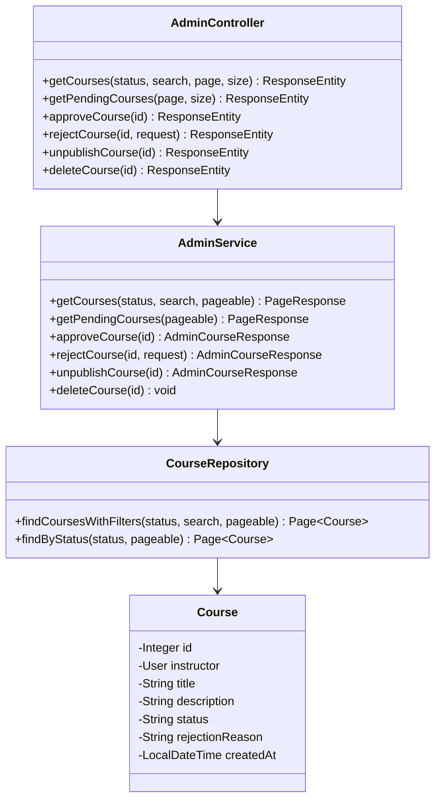

# Phase 2 Implementation Plan — Course Governance & Moderation

**Target Module:** Admin Backend (Spring Boot)  
**Features Covered:**
- Feature 15: Course Approval Workflow (`FR-A06`, `FR-A07`)
- Feature 16: Master Course Directory & Oversight (`FR-A09`)
- Feature 17: Unpublish & Removal Governance (`FR-A08`)
**Dependencies on other teammates:** Uses `courses` table from `01-schema.sql`. Creates the base `Course.java` entity and `CourseRepository.java` which Person 3 (Instructor Backend) and Person 4 (Student Backend) will later share.

---

## 1. Goal Description

Provide end-to-end course lifecycle oversight for administrators:
1. **Course Review Queue**: When instructors submit a course for review (`pending_review`), admins can review its curriculum and either approve it (publishing it to the student catalog) or reject it with structured feedback.
2. **Master Course Directory**: Allow admins to inspect all platform courses regardless of status (`draft`, `pending_review`, `published`, `rejected`), with pagination, keyword search, and instructor attribution.
3. **Emergency Moderation / Takedown**: Give administrators immediate controls to unpublish offending courses (returning them to draft) or permanently remove them from the database.

---

## 2. Database Adjustments Required (Prerequisites)

Ensure the `courses` table in `db/01-schema.sql` (and your local Postgres instance) supports review states and feedback:

```sql
-- 1. Extend allowed course status values
ALTER TABLE courses DROP CONSTRAINT IF EXISTS chk_courses_status;
ALTER TABLE courses ADD CONSTRAINT chk_courses_status 
    CHECK (status IN ('draft', 'pending_review', 'published', 'rejected'));

-- 2. Add rejection_reason column for feedback to instructors
ALTER TABLE courses ADD COLUMN IF NOT EXISTS rejection_reason TEXT;

-- 3. Seed sample pending course for testing review queue
-- Assumes instructor with ID 2 exists in users table
INSERT INTO courses (instructor_id, title, description, status)
VALUES (2, 'Complete Spring Boot 3 & Security', 'Comprehensive masterclass on modern microservices.', 'pending_review')
ON CONFLICT DO NOTHING;
```

---

## 3. Architecture & Class Diagram



---

## 4. Proposed Code Changes

### A. Entity Layer
#### `[NEW] backend/src/main/java/com/olp/entity/Course.java`
Maps the `courses` table defined in `db/01-schema.sql`:
```java
package com.olp.entity;

import jakarta.persistence.*;
import java.time.LocalDateTime;

@Entity
@Table(name = "courses")
public class Course {

    @Id
    @GeneratedValue(strategy = GenerationType.IDENTITY)
    private Integer id;

    @ManyToOne(fetch = FetchType.LAZY)
    @JoinColumn(name = "instructor_id", nullable = false)
    private User instructor;

    @Column(nullable = false, length = 200)
    private String title;

    @Column(columnDefinition = "TEXT")
    private String description;

    @Column(nullable = false, length = 20)
    private String status = "draft";

    @Column(name = "rejection_reason", columnDefinition = "TEXT")
    private String rejectionReason;

    @Column(name = "created_at", nullable = false, updatable = false)
    private LocalDateTime createdAt;

    @PrePersist
    protected void onCreate() {
        this.createdAt = LocalDateTime.now();
    }

    // constructors, getters, setters
}
```

### B. Repository Layer
#### `[NEW] backend/src/main/java/com/olp/repository/CourseRepository.java`
```java
package com.olp.repository;

import com.olp.entity.Course;
import org.springframework.data.domain.Page;
import org.springframework.data.domain.Pageable;
import org.springframework.data.jpa.repository.JpaRepository;
import org.springframework.data.jpa.repository.Query;
import org.springframework.data.repository.query.Param;
import org.springframework.stereotype.Repository;

@Repository
public interface CourseRepository extends JpaRepository<Course, Integer> {

    Page<Course> findByStatus(String status, Pageable pageable);

    @Query("SELECT c FROM Course c JOIN FETCH c.instructor WHERE " +
           "(:status IS NULL OR c.status = :status) AND " +
           "(:search IS NULL OR LOWER(c.title) LIKE LOWER(CONCAT('%', :search, '%')) OR LOWER(c.description) LIKE LOWER(CONCAT('%', :search, '%')))")
    Page<Course> findCoursesWithFilters(
            @Param("status") String status,
            @Param("search") String search,
            Pageable pageable);
}
```

### C. DTO Layer
#### `[NEW] backend/src/main/java/com/olp/dto/AdminCourseResponse.java`
Full course details including instructor metadata:
```java
public class AdminCourseResponse {
    private Integer id;
    private String title;
    private String description;
    private Integer instructorId;
    private String instructorName;
    private String instructorEmail;
    private String status;
    private String rejectionReason;
    private LocalDateTime createdAt;
    // constructors, getters, setters
}
```

#### `[NEW] backend/src/main/java/com/olp/dto/RejectCourseRequest.java`
Validation payload when an administrator rejects a course:
```java
public class RejectCourseRequest {
    @NotBlank(message = "Rejection reason cannot be blank")
    private String reason;

    // getter, setter
}
```

### D. Service & Controller Layer
#### `[MODIFY] backend/src/main/java/com/olp/service/AdminService.java`
Add course governance methods:
- `getCourses(String status, String search, Pageable pageable)`: Returns paginated `AdminCourseResponse` items.
- `getPendingCourses(Pageable pageable)`: Returns courses awaiting approval (`status = 'pending_review'`).
- `approveCourse(Integer courseId)`: Sets status to `'published'`, clears any prior `rejectionReason`.
- `rejectCourse(Integer courseId, RejectCourseRequest request)`: Sets status to `'rejected'` and saves `rejectionReason`.
- `unpublishCourse(Integer courseId)`: Sets status to `'draft'` (takes course down immediately from public student catalog).
- `deleteCourse(Integer courseId)`: Permanently deletes the course (cascades lectures & enrollments).

#### `[MODIFY] backend/src/main/java/com/olp/controller/AdminController.java`
Add REST endpoints:
- `GET /api/admin/courses?status=&search=&page=&size=` — Master course directory
- `GET /api/admin/courses/pending?page=&size=` — Pending approval queue
- `PUT /api/admin/courses/{id}/approve` — Approve course to published
- `PUT /api/admin/courses/{id}/reject` — Reject course with reason body
- `PUT /api/admin/courses/{id}/unpublish` — Emergency unpublish
- `DELETE /api/admin/courses/{id}` — Permanently delete course

---

## 5. Verification Plan

1. **Compilation Check**:
   - `mvn clean compile` verifies the new `Course` entity and repository relationships.
2. **Pending Queue Inspection**:
   - Call `GET /api/admin/courses/pending` as Admin. Expect the seeded course with status `pending_review`.
3. **Approve Workflow**:
   - Call `PUT /api/admin/courses/{id}/approve`.
   - Verify course status becomes `published` and `rejectionReason` is null.
4. **Reject Workflow**:
   - Call `PUT /api/admin/courses/{id}/reject` with `{ "reason": "Course audio quality is below threshold" }`.
   - Verify course status becomes `rejected` and reason is persisted.
5. **Unpublish & Delete**:
   - Call `PUT /api/admin/courses/{id}/unpublish` -> status moves to `draft`.
   - Call `DELETE /api/admin/courses/{id}` -> returns 200 and removes record.
